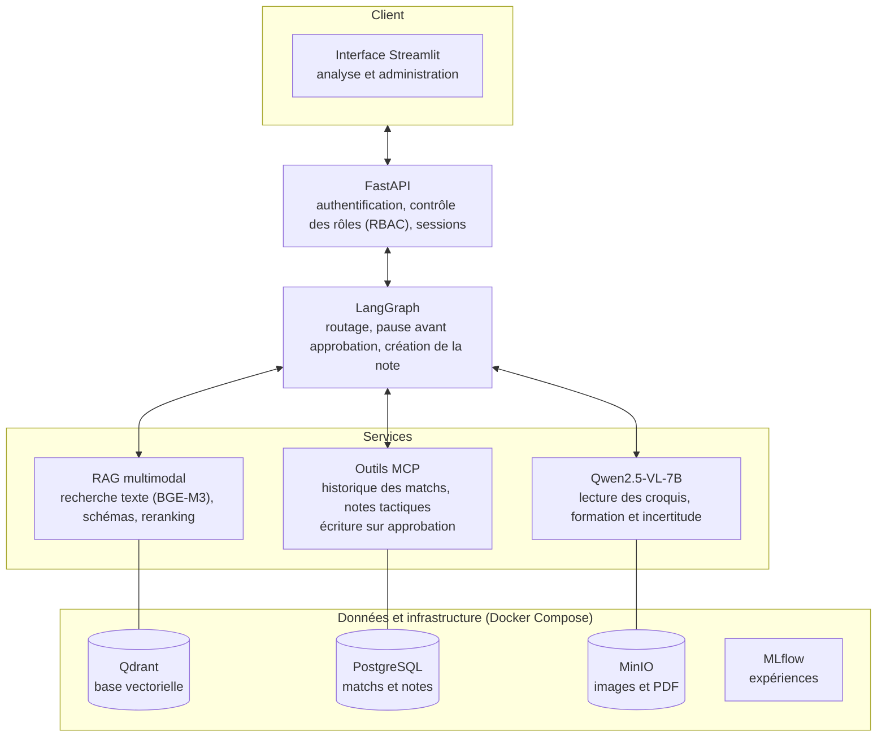
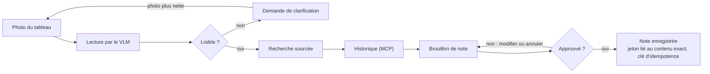

# TactIQ

*Assistant documentaire multimodal et agentique pour l'analyse tactique de football*

## Résumé

TactIQ est un assistant pour entraîneurs de football : il lit la photo d'un tableau tactique, répond avec des citations de documents (document et page) et prépare une note tactique que l'entraîneur valide avant tout enregistrement.

- **Positionnement.** Dans la littérature et les outils examinés, les travaux sur le football portent sur le tracking ou les bases structurées ; aucun ne combine photo de tableau, documents de coaching cités et approbation d'une note.
- **Architecture.** Cinq couches, avec un seul point d'écriture : le serveur MCP, après approbation.
- **Planning.** Un plan détaillé sur 15 jours, en 5 phases et 5 jalons, mène au socle documentaire de l'étape 1.
- **Point de décision.** Le go / no-go du corpus (au moins 30 documents exploitables) est pris au jour 3 et consigné à la section 10 (indicateurs).

## Sommaire

1. [Cadrage](#1-cadrage)
2. [Objectifs](#2-objectifs)
3. [Problématique](#3-problématique)
4. [État de l'art](#4-état-de-lart)
5. [Étude de l'existant](#5-étude-de-lexistant)
6. [Architecture](#6-architecture)
7. [Données et corpus](#7-données-et-corpus)
8. [Sécurité, droits d'accès et validation humaine](#8-sécurité-droits-daccès-et-validation-humaine)
9. [Planning détaillé sur 15 jours](#9-planning-détaillé-sur-15-jours)
10. [Jalons, livrables et critères d'acceptation](#10-jalons-livrables-et-critères-dacceptation)
11. [Plan de tests et d'évaluation](#11-plan-de-tests-et-dévaluation)
12. [Risques et plan de repli](#12-risques-et-plan-de-repli)
13. [Après les 15 jours : suite du projet](#13-après-les-15-jours--suite-du-projet)

## 1. Cadrage

**Contexte.** Le projet intégrateur d'IA générative multimodale et agentique se déroule en quatre étapes : RAG textuel, multimodalité avec adaptation d'un reranker, orchestration agentique avec MCP, puis bot et déploiement. TactIQ applique ce cadre au football. La note tactique y joue le rôle du ticket de maintenance : elle est préparée par l'assistant, consultée dans un historique et soumise à une validation humaine.

**Besoin.** Un entraîneur prépare ses matchs avec un tableau magnétique, des notes dispersées et des supports techniques difficiles à retrouver rapidement. Il lui faut un moyen de retrouver ce que disent ses documents sur une formation, de rappeler ce qui a été joué lors des derniers matchs et de rédiger vite une note propre.

**Périmètre retenu**

- Reconnaissance de 8 à 10 formations standard à partir d'une photo ou d'un croquis, avec demande de clarification si l'image est ambiguë.
- Réponses documentaires sourcées sur les principes de jeu, points forts et zones faibles.
- Consultation d'un historique d'environ 10 équipes et 200 matchs, simulé ou construit à partir de données ouvertes.
- Brouillon de note tactique, approbation explicite, enregistrement sans doublon.
- Accès par bot Telegram et interface Streamlit.

**Utilisateurs et rôles**

| Rôle | Droits |
| --- | --- |
| Entraîneur principal | Questions, schémas, historique, modification, approbation et enregistrement des notes |
| Entraîneur adjoint | Questions, analyse de croquis, historique, brouillons sans approbation |
| Joueur | Lecture seule des notes publiées |

Les permissions sont vérifiées côté serveur et chaque document porte un niveau d'accès minimal, appliqué dès la recherche vectorielle.

**Contraintes.** Aucune décision autonome et aucune promesse de résultat sportif. Approbation humaine obligatoire. Citations vérifiables. Documents externes traités comme entrées non fiables. Respect du droit d'auteur et de la vie privée : pas de photo de joueur identifiable ni de mineur sans autorisation.

**Hors périmètre.** Analyse vidéo continue, détection automatique des joueurs sur un match entier, prédiction de résultats.

## 2. Objectifs

**Objectif général.** Construire progressivement un assistant multimodal et agentique qui aide un entraîneur à préparer ses matchs : lecture d'un schéma tactique, réponses sourcées, consultation de l'historique, brouillon de note validé par un humain.

**Objectifs spécifiques.** Chaque étape livre une version utilisable et se ferme sur un critère de validation. Les valeurs cibles des indicateurs seront fixées après une première mesure, puis reportées comme objectifs ou résultats observés, jamais comme garanties.

| Étape | Objectif spécifique | Indicateur de réussite |
| --- | --- | --- |
| 1. RAG textuel | Répondre à une question tactique à partir d'un corpus de 30 à 50 documents autorisés | Chaque réponse cite un document et une page vérifiables, filtrés selon le rôle |
| 2. Multimodal | Lire un tableau ou un croquis et retrouver les passages liés ; adapter un reranker | Exactitude de la formation reconnue, qualité des demandes de clarification, nDCG@5 et MRR@10 sans reranker, avec reranker initial et avec reranker adapté |
| 3. Agentique et MCP | Consulter l'historique et préparer une note via un workflow interrompu pour approbation | Aucune note enregistrée sans approbation explicite ; aucun doublon |
| 4. Bot et déploiement | Rendre le système utilisable par Telegram, testé et reproductible | Environ 150 scénarios évalués : rôles, injections de prompt, approbation, latence |

**Objectif de l'étape en cours.** Disposer d'un socle documentaire fiable : corpus validé (go / no-go), pipeline d'ingestion, index vectoriel avec droits d'accès, chaîne RAG et première interface de démonstration. Le planning de la section 9 découpe cet objectif en 15 journées.

## 3. Problématique

**Question centrale.** Comment concevoir un assistant qui, à partir de la photo d'un tableau tactique, produit des réponses documentaires vérifiables et prépare une note tactique, sans décider à la place de l'entraîneur et sans rien enregistrer qu'il n'ait approuvé ?

**Questions de recherche**

1. Peut-on reconnaître une formation sur une photo ou un croquis avec un modèle vision-langage à poids ouverts, et savoir quand répondre « image trop ambiguë » ?
2. Sur un petit corpus spécialisé, un reranker adapté améliore-t-il la récupération par rapport à un reranker générique, mesuré par nDCG@5 et MRR@10 ?
3. Comment garantir qu'une approbation est liée au contenu exact de la note et à l'utilisateur, et qu'une note ne soit pas créée deux fois ?
4. Comment filtrer les passages selon le rôle dès la recherche et rester robuste face à une instruction malveillante cachée dans un document ?

**Verrous identifiés**

| Verrou | Nature | Traitement prévu |
| --- | --- | --- |
| Corpus tactique ouvert limité | Données | Go / no-go immédiat ; sources externes complétées par des fiches rédigées en propre |
| Absence de jeu public de tableaux annotés | Données | Diagrammes générés, photos de vrais tableaux, croquis, vues issues de données de tracking |
| Lecture spatiale d'un tableau chargé | Modèle | Hypothèse à tester : le modèle peut se tromper quand les aimants se chevauchent ; limiter à 8 à 10 formations et mesurer séparément les cas difficiles |
| Réponses tactiques subjectives | Évaluation | Évaluer la récupération, les citations et la lecture des formations, pas la « meilleure tactique » |
| Action sensible | Sécurité | Interruption du workflow, jeton d'approbation lié au contenu, clé d'idempotence |

## 4. État de l'art

Chaque brique de TactIQ est documentée dans la littérature, mais les travaux sur le football portent sur des données de tracking ou des bases structurées, pas sur la lecture d'un tableau tactique par un entraîneur.

### Briques techniques

| Brique | Référence | Ce que le travail établit | Usage dans TactIQ |
| --- | --- | --- | --- |
| Génération augmentée par la recherche (RAG) | Lewis et al., 2020 | Un modèle seq2seq pré-entraîné est couplé à un index dense de Wikipédia ; résultats à l'état de l'art sur trois tâches de questions-réponses ouvertes, avec des sorties plus factuelles qu'un modèle seul | Réponses ancrées dans le corpus, avec citation du document et de la page |
| Embeddings multilingues | BGE-M3, Chen et al. | Plus de 100 langues, entrées jusqu'à 8 192 tokens, recherche dense, multi-vecteurs et éparse dans un seul modèle | Indexation du corpus français et anglais dans Qdrant |
| Reranking | Entraînement de rerankers (Hugging Face) ; bge-reranker-base | Un cross-encoder note la requête et le passage ensemble : plus précis mais plus lent qu'un bi-encodeur, donc appliqué au top-k. Un gain est rapporté après adaptation à son propre domaine, avec la réserve que ce domaine ressemblait aux données des modèles comparés | Comparer trois configurations : sans reranker, reranker initial, reranker adapté |
| Recherche texte-image | CLIP, Radford et al., 2021 | Apprentissage sur 400 millions de paires image-texte ; transfert sans entraînement spécifique sur plus de 30 jeux de données | Encodeur compatible CLIP pour indexer les schémas des documents |
| Modèle vision-langage | Qwen2.5-VL | Reconnaissance visuelle, localisation par boîtes ou points, analyse de diagrammes et de mises en page ; trois tailles de modèle | Lecture des croquis et tableaux ; la version 7B est le choix de la feuille de route |
| Limite des VLM sur l'occlusion | CAPTURe, 2025 | Sur six VLM, l'erreur de comptage passe de 21,95 % à 27,59 % sur images réelles quand des objets sont cachés ; les humains font bien mieux ; fournir les coordonnées en texte améliore nettement les résultats | Justifie la demande de clarification et une piste à tester : extraire des positions, puis classer la formation |
| Workflow avec validation humaine | LangGraph, interruptions | `interrupt()` met le graphe en pause, l'état est sauvegardé par un checkpointer et repris avec le même `thread_id` ; le nœud redémarre au début à la reprise, donc les effets de bord doivent être idempotents | Pause avant création de la note, reprise après `/approve` |
| Accès aux outils | Model Context Protocol | Standard ouvert qui relie une application d'IA à des données, des outils et des workflows | Serveur MCP pour l'historique des matchs et les notes |

### Travaux sur le football

| Travail | Ce qu'il fait | Limite pour notre cas |
| --- | --- | --- |
| TacticAI (Google DeepMind et Liverpool FC, Nature Communications, 2024) | Assistant sur les corners : prédit le premier receveur et la possibilité d'un tir, propose des ajustements de positions, retrouve des corners similaires. Données : 7 176 corners de Premier League pour le benchmark. Précision top-3 du receveur : 0,782. Cinq experts du club jugent favorables 45 des 50 ajustements évalués | Données de tracking et modèle sur graphes, pas de photo ni de documents de coaching ; les auteurs présentent l'étude comme limitée en taille |
| SoccerRAG (Strand et al.) | RAG sur 550 matchs de SoccerNet : un LLM extrait les propriétés de la question, les valide dans une base SQLite puis écrit des requêtes SQL | Le chemin évalué porte sur des données structurées ; la vidéo et l'image sont listées comme travaux futurs ; évaluation préliminaire ; limites reconnues sur les listes longues et la variabilité des réponses |
| SoccerNet-v2 (Deliège et al.) | 500 vidéos de matchs diffusés, environ 300 000 annotations, pour le repérage d'actions, la segmentation de plans et la localisation de rediffusions | Jeu de vidéos de diffusion, pas de tableaux tactiques ni de formations annotées |

### Positionnement

Aucun des travaux examinés ne combine la lecture d'une photo de tableau tactique, la recherche dans des documents de coaching avec citation de page et une note validée par un humain. TactIQ assemble des briques connues dans ce cas d'usage, et sa contribution porte sur trois points mesurables : la reconnaissance des formations avec clarification, l'effet d'un reranker adapté sur un petit corpus tactique, et la chaîne d'approbation idempotente.

Ce positionnement vient d'une recherche limitée : une revue de littérature plus large reste à faire avant le rapport final.

## 5. Étude de l'existant

Les outils du marché couvrent la vidéo, les statistiques et le dessin tactique, mais les pages consultées ne décrivent ni lecture IA d'un tableau photographié, ni recherche citée dans les documents du staff, ni note tactique validée par un rôle défini.

| Outil | Ce que la page consultée décrit | Écart avec TactIQ |
| --- | --- | --- |
| Hudl, analyse vidéo football | Analyse et revue vidéo (Sportscode), télestrations (Studio), partage de listes de lecture, analyses personnalisées (Insight), base Wyscout de vidéos et de statistiques, caméras Focus « alimentées par l'IA » pour la capture | L'IA est décrite pour la capture des matchs, pas pour l'analyse ; recherche en langage naturel non mentionnée ; outil centré sur la vidéo |
| Hudl StatsBomb | Données d'événements et 360, plus de 160 métriques, plus de 170 compétitions, module tactique, réseaux de passes, liaison avec la vidéo Wyscout, résumés de joueurs générés par IA | Analyse de données de match ; pas de documents de coaching propres au club ni de validation de notes mentionnés |
| Tacbo, tableau tactique | Application gratuite avec achats intégrés de 0,99 à 4,99 dollars : placement des joueurs, dessin tactile, sauvegarde du tableau en image, partage | Sert à dessiner le tableau, pas à l'interpréter ni à le relier à des documents |

Les prototypes de recherche TacticAI, SoccerRAG et SoccerNet-v2 sont décrits dans l'état de l'art. L'absence d'une fonction sur une page ne prouve pas qu'elle n'existe pas ailleurs dans le produit : ce tableau rapporte seulement ce que ces pages disent.

### Ce que TactIQ apporte

- **Entrée par l'image du tableau.** L'entraîneur envoie la photo de l'outil qu'il utilise déjà, sans saisie manuelle.
- **Réponses tirées des documents du staff.** Chaque passage est cité avec son document et sa page, filtré selon le rôle.
- **Mémoire des matchs interrogeable.** Formations jouées et résultats via un serveur MCP.
- **Note brouillon puis approbation.** Rien n'est enregistré sans validation explicite, sans doublon.

### Ce que TactIQ ne fait pas

Pas d'analyse vidéo, pas de données de tracking en direct, pas de métriques avancées de joueurs. C'est un prototype académique sur un corpus limité, pas un concurrent de ces plateformes professionnelles.

## 6. Architecture

L'interface Streamlit parle à FastAPI, qui vérifie le rôle. LangGraph orchestre trois services (RAG multimodal, VLM, outils MCP) adossés à Qdrant, PostgreSQL et MinIO. Seul le serveur MCP peut créer une note, et il exige un jeton d'approbation.

### Flux d'une photo de tableau

La pause du graphe LangGraph a lieu au niveau de la décision « Approuvé ? » : tant que l'entraîneur principal n'approuve pas, la note reste un brouillon. Si l'image est ambiguë, l'assistant demande une photo plus nette au lieu de deviner.

### Choix techniques

| Composant | Choix | Rôle |
| --- | --- | --- |
| Extraction des documents | PyMuPDF, OCR local si besoin | Texte et pages des PDF |
| Embeddings | BGE-M3 | Recherche sémantique multilingue |
| Base vectorielle | Qdrant | Index des passages, filtre par rôle |
| Chaîne RAG | LangChain | Récupération et génération sourcée |
| API | FastAPI | Authentification, rôles, sessions |
| Orchestration | LangGraph | Graphe d'états, pause avant approbation |
| Modèle vision-langage | Qwen2.5-VL-7B-Instruct | Lecture des croquis et tableaux |
| Outils | Serveur et client MCP | Historique des matchs, notes tactiques |
| Stockage | PostgreSQL, MinIO | Matchs et notes, images et PDF |
| Suivi et déploiement | MLflow, Docker Compose | Expériences, déploiement reproductible |
| Client | Streamlit | Analyse et administration |

## 7. Données et corpus

Le corpus est la ressource critique de l'étape 1 : sans au moins 30 documents exploitables, le projet ne s'engage pas plus loin. Cette section fixe la façon de le constituer et de le contrôler.

### Familles de données

| Famille | Contenu | Usage | Point de vigilance |
| --- | --- | --- | --- |
| Documents de coaching | 30 à 50 PDF tactiques (principes de jeu, formations, points forts et zones faibles) | Index RAG avec citation document et page | Licence, version et niveau d'accès consignés pour chaque document |
| Fiches rédigées en propre | Synthèses courtes par formation, écrites pour combler les manques du corpus ouvert | Complément du corpus si le seuil de 30 n'est pas atteint | Marquées comme telles dans les métadonnées |
| Historique des matchs | Environ 10 équipes et 200 matchs, simulés ou issus de données ouvertes | Consultation via le serveur MCP (étape 3) | Le dépôt StatsBomb exige de citer StatsBomb ; son fichier de licence complet doit être lu avant usage |
| Images tactiques | Diagrammes générés, photos de tableaux magnétiques, croquis, vues issues de tracking | Évaluation du VLM et du reranker (étape 2) | Séparer le jeu de développement du jeu de test dès le départ ; aucune photo de joueur identifiable ni de mineur sans autorisation |

### Métadonnées obligatoires par passage

- Identifiant du document, titre, numéro de page.
- Source, licence et version du document.
- Langue (français ou anglais).
- Niveau d'accès minimal (staff ou lecture publique) appliqué comme filtre dès la recherche vectorielle.
- Origine : document externe ou fiche rédigée en propre.

### Critères d'exploitabilité d'un document

- Texte extractible ou OCR de qualité suffisante, avec pagination fiable.
- Licence compatible avec l'usage prévu, vérifiée et consignée.
- Contenu pertinent pour au moins une des 8 à 10 formations du périmètre.
- Aucune instruction suspecte détectée à la lecture (les documents restent traités comme entrées non fiables).

## 8. Sécurité, droits d'accès et validation humaine

TactIQ prépare une action sensible, l'enregistrement d'une note. La sécurité repose sur quatre garde-fous, testés dès l'étape 1 pour les deux premiers.

| Garde-fou | Mécanisme | Test associé |
| --- | --- | --- |
| Droits par rôle | Rôle vérifié côté serveur ; niveau d'accès minimal porté par chaque passage et appliqué dans la requête Qdrant | Un joueur ne reçoit aucun passage réservé au staff (aucune fuite) |
| Documents non fiables | Passages traités comme des données, jamais comme des instructions | Tests d'injection de prompt avec une consigne malveillante cachée dans un document |
| Approbation explicite | Workflow LangGraph interrompu ; jeton d'approbation lié au contenu exact de la note et à l'utilisateur | Aucune note enregistrée sans approbation (étape 3) |
| Idempotence | Clé d'idempotence : le même ordre ne crée jamais deux notes, même si le nœud redémarre à la reprise | Rejouer une approbation ne produit aucun doublon (étape 3) |

Principe général : l'assistant ne décide jamais à la place de l'entraîneur et ne promet aucun résultat sportif.

## 9. Planning détaillé sur 15 jours

Le planning couvre l'étape 1 (RAG textuel) et prépare l'étape 2. Il est organisé en cinq phases de trois jours, chacune fermée par un jalon de contrôle (J3, J6, J9, J12, J15). Il suppose un travail continu ; si une journée glisse, on reporte la suivante sans sauter le jalon.

### Phase 1 · Cadrage et décision sur le corpus (J1 à J3)

| Jour | Tâches | Livrable ou critère |
| --- | --- | --- |
| J1 | **Cadrer et préparer l'environnement.** Relire le périmètre, figer la liste des 8 à 10 formations à reconnaître, créer le dépôt, lancer Qdrant, PostgreSQL et MinIO avec Docker Compose. | Liste de formations figée ; environnement qui démarre |
| J2 | **Recenser le corpus ouvert.** Collecter les documents tactiques candidats (PDF) et ouvrir le tableau de suivi : source, licence, version, langue, niveau d'accès. | Tableau de suivi avec tous les documents candidats |
| J3 | **Contrôler l'exploitabilité et décider.** Vérifier texte extractible, pagination et licence (lire la licence complète de StatsBomb avant tout usage) ; rédiger des fiches propres si besoin ; compter les documents exploitables. | **Jalon 1 : décision go / no-go** (au moins 30 documents) consignée dans les indicateurs (section 10) |

### Phase 2 · Ingestion et indexation (J4 à J6)

| Jour | Tâches | Livrable ou critère |
| --- | --- | --- |
| J4 | **Construire le pipeline d'extraction.** PyMuPDF pour le texte et les pages, OCR local pour les scans, découpage en passages qui gardent leur numéro de page ; essai sur 5 documents. | Script d'ingestion validé sur 5 documents |
| J5 | **Ajouter métadonnées et droits.** Schéma de métadonnées complet, niveau d'accès par passage, stockage des PDF et images dans MinIO, ingestion de tout le corpus. | Corpus ingéré ; journal d'ingestion sans erreur bloquante |
| J6 | **Indexer dans Qdrant.** Embeddings BGE-M3, filtre par niveau d'accès appliqué dans la requête, contrôle que chaque passage porte une page et un niveau d'accès. | **Jalon 2 : L1.3 index et métadonnées** ; 100 % des passages avec page et niveau d'accès |

### Phase 3 · API et chaîne RAG (J7 à J9)

| Jour | Tâches | Livrable ou critère |
| --- | --- | --- |
| J7 | **Mettre en place l'API.** FastAPI : authentification, sessions et les trois rôles ; rôle vérifié côté serveur à chaque appel. | Endpoints testés avec les trois rôles |
| J8 | **Construire la chaîne RAG.** LangChain : récupération filtrée par rôle, génération avec citation du document et de la page ; réponse prudente quand aucun passage ne soutient l'affirmation. | Réponses citées sur 10 questions de test |
| J9 | **Durcir et suivre.** Encadrer les passages comme des données, premiers tests d'injection de prompt, suivi des essais dans MLflow. | **Jalon 3 : L1.4 API et chaîne RAG** ; premiers tests d'injection réalisés |

### Phase 4 · Interface et préparation de l'étape 2 (J10 à J12)

| Jour | Tâches | Livrable ou critère |
| --- | --- | --- |
| J10 | **Réaliser l'interface Streamlit.** Saisie d'une question, réponse avec citations cliquables (document et page), choix du rôle de démonstration. | L1.5 première version de l'interface |
| J11 | **Tester le modèle vision-langage.** Installer Qwen2.5-VL-7B-Instruct (quantifié si besoin) et le tester sur 10 images ; définir le schéma Pydantic de sortie : formation, confiance, citations, questions de clarification. | Résultats du test sur 10 images ; schéma Pydantic écrit |
| J12 | **Constituer les images.** Générer un premier lot de diagrammes avec mplsoccer étiquetés par formation (objectif final : 100 à 150), photographier des tableaux magnétiques, extraire les schémas des documents du corpus. | **Jalon 4 : premier lot d'images** et règle de séparation développement / test |

### Phase 5 · Tests, évaluation et bilan (J13 à J15)

| Jour | Tâches | Livrable ou critère |
| --- | --- | --- |
| J13 | **Mesurer les citations.** Rédiger un jeu de questions documentaires et vérifier, réponse par réponse, que la citation soutient l'affirmation. | Tableau de mesure des citations |
| J14 | **Tester accès et injections.** Jouer les trois rôles, vérifier qu'un joueur n'obtient aucun passage réservé au staff, rejouer les injections de prompt, corriger les défauts relevés. | L1.6 rapport de tests documentaires et d'accès (première version) |
| J15 | **Faire le bilan.** Renseigner les statuts et les indicateurs de la section 10 avec les valeurs observées, démonstration de bout en bout, fixer les cibles de l'étape 2 après la première mesure, relecture du document. | **Jalon 5 : L1.1 validé** et bilan de l'étape 1 |

### Réserve de temps et règle de repli

- Si le go / no-go est négatif au jour 3 : arrêt du planning et changement de sujet, comme prévu au cadrage.
- Si l'OCR ralentit l'ingestion (J4 à J5) : traiter d'abord les PDF à texte natif, repousser les scans.
- Si le GPU est insuffisant pour le VLM (J11) : version quantifiée, GPU loué ou modèle plus petit.
- Les tâches de la phase 4 liées au VLM (J11 et J12) peuvent glisser après J15 sans bloquer l'étape 1.

## 10. Jalons, livrables et critères d'acceptation

Les six livrables de l'étape 1 sont rattachés à une échéance du planning. Les statuts ci-dessous sont ceux du dernier état connu ; ils se mettent à jour au fil des jalons.

| Réf. | Livrable | Échéance | Statut | Critère d'acceptation |
| --- | --- | --- | --- | --- |
| L1.1 | Note de cadrage et architecture | J15 | En cours | Sections 1 à 10 de ce document relues et validées |
| L1.2 | Pipeline d'ingestion documentaire | J5 | À compléter | Corpus ingéré avec page et métadonnées, journal sans erreur bloquante |
| L1.3 | Index Qdrant et métadonnées | J6 | À compléter | Tous les passages indexés avec page et niveau d'accès |
| L1.4 | API FastAPI et chaîne RAG | J9 | À compléter | Réponses citées, filtrées par rôle ; premiers tests d'injection |
| L1.5 | Interface de démonstration Streamlit | J10 | À compléter | Question, réponse et citations affichées pour les trois rôles |
| L1.6 | Rapport de tests documentaires et d'accès | J14 | À compléter | Mesure des citations ; aucune fuite d'un passage staff vers un joueur |

Statuts possibles : Non commencé, En cours, Terminé.

### Indicateurs de l'étape 1

| Indicateur | Cible de la feuille de route | Mesuré à | Valeur observée |
| --- | --- | --- | --- |
| Documents exploitables collectés (décision go / no-go) | 30 à 50, avec au moins 30 avant engagement complet | J3 | à renseigner |
| Documents avec source, licence et version consignées | Tous | J3 | à renseigner |
| Passages indexés avec page et niveau d'accès | Tous | J6 | à renseigner |
| Réponses de test dont la citation soutient l'affirmation | À mesurer | J13 | à renseigner |
| Accès refusé à un joueur pour un passage réservé au staff | Aucune fuite | J14 | à renseigner |

Les cibles chiffrées marquées « à mesurer » sont fixées après la première mesure, puis reportées comme objectifs ou résultats observés, jamais comme garanties.

## 11. Plan de tests et d'évaluation

Les tests de l'étape 1 portent sur la récupération documentaire, les citations et les droits d'accès. On évalue ce que le système retrouve et cite, pas la « meilleure tactique ».

| Famille de tests | Ce qu'on vérifie | Jour | Critère |
| --- | --- | --- | --- |
| Ingestion | Texte, page et métadonnées conservés, OCR lisible | J4–J6 | Aucun passage sans page ni niveau d'accès |
| Récupération | Les passages remontés correspondent à la question posée | J8 | Contrôle manuel sur 10 questions |
| Citations | Le document et la page cités soutiennent l'affirmation | J13 | Proportion mesurée, cible fixée après la mesure |
| Droits d'accès | Le joueur ne reçoit aucun passage réservé au staff ; les trois rôles testés | J14 | Aucune fuite |
| Injection de prompt | Une consigne cachée dans un document n'est pas exécutée | J9, J14 | Consigne ignorée, réponse inchangée |
| Démonstration | Parcours complet question, réponse citée, interface | J15 | Démo sans intervention manuelle |

Les mesures de l'étape 2 (exactitude des formations, nDCG@5 et MRR@10 sans reranker, avec reranker initial et avec reranker adapté) et les environ 150 scénarios de l'étape 4 sont préparés par le jeu d'images constitué en phase 4 et par la règle de séparation développement / test.

## 12. Risques et plan de repli

Le risque principal reste le corpus ouvert de tactique, suivi de la lecture des tableaux chargés par le modèle vision-langage.

| Risque | Mesure prévue | Jour concerné |
| --- | --- | --- |
| Corpus ouvert insuffisant | Vérification immédiate ; au moins 30 documents exploitables avant engagement complet, sinon changer de sujet | J2–J3 |
| Le VLM se trompe sur un tableau chargé | Périmètre de 8 à 10 formations, demande de clarification, mesure séparée des cas difficiles ; piste à tester : extraire des positions puis classer la formation | J11–J12 |
| Peu d'images réelles disponibles | Diagrammes générés avec étiquettes exactes et photos de vrais tableaux prises soi-même | J12 |
| Licences des données ouvertes | Le dépôt StatsBomb demande de citer StatsBomb comme source et d'utiliser son logo ; son fichier de licence complet n'a pas été lu et doit l'être avant usage | J3 |
| GPU insuffisant pour le VLM de 7 milliards de paramètres | Quantification, GPU loué ou modèle plus petit | J11 |
| Instruction malveillante cachée dans un document | Passages traités comme des données, tests d'injection de prompt | J9, J14 |
| Retard sur une phase | Report de la journée suivante, jalon maintenu ; les tâches VLM de la phase 4 peuvent glisser après J15 | Toutes |

## 13. Après les 15 jours : suite du projet

Une fois le socle documentaire validé, la suite reprend les étapes du cadre général.

| Étape | Travail à engager | Point de départ déjà préparé |
| --- | --- | --- |
| 2. Multimodal | Reconnaissance de formations, indexation des schémas du corpus, adaptation du reranker (objectif : 800 à 1 500 exemples), mesure avec trois configurations | Liste de formations figée, schéma Pydantic, premier lot d'images, séparation développement / test |
| 3. Agentique et MCP | Serveur MCP (historique, notes), workflow LangGraph interrompu, jeton d'approbation lié au contenu, clé d'idempotence | API et rôles de l'étape 1 |
| 4. Bot et déploiement | Bot Telegram, environ 150 scénarios de test, déploiement reproductible avec Docker Compose | Interface Streamlit et rapport de tests de l'étape 1 |

Avant le rapport final, une revue de littérature plus large reste à faire, comme indiqué dans le positionnement.
