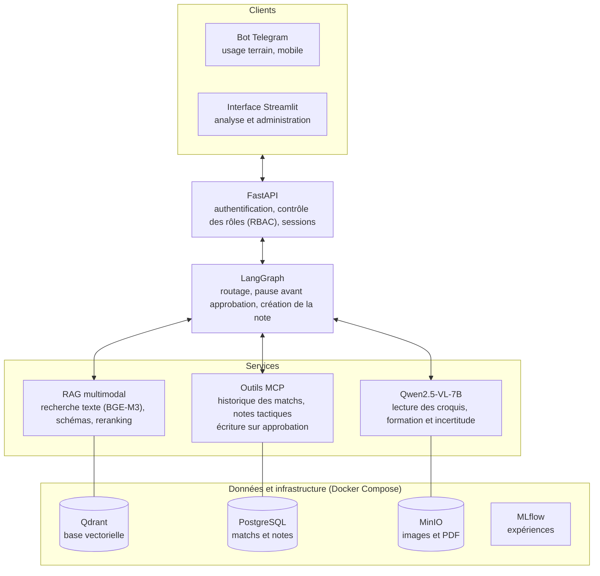
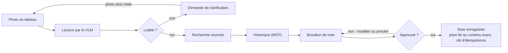

# TactIQ

*Assistant documentaire multimodal et agentique pour l'analyse tactique de football*

## Résumé

TactIQ est un assistant pour entraîneurs de football : il lit la photo d'un tableau tactique, répond avec des citations de documents (document et page) et prépare une note tactique que l'entraîneur valide avant tout enregistrement.

- **Positionnement.** Dans les sources consultées, les travaux sur le football portent sur le tracking ou les bases structurées ; aucun ne combine photo de tableau, documents de coaching cités et approbation d'une note.
- **Architecture.** Cinq couches, avec un seul point d'écriture : le serveur MCP, après approbation.
- **Point de décision.** Le go / no-go du corpus (au moins 30 documents exploitables) est à consigner dans la section Avancement.

## 1. Cadrage

**Contexte.** Le projet intégrateur d'IA générative multimodale et agentique se déroule en quatre étapes : RAG textuel, multimodalité avec adaptation d'un reranker, orchestration agentique avec MCP, puis bot et déploiement. TactIQ applique ce cadre au football. La note tactique y joue le rôle du ticket de maintenance : elle est préparée par l'assistant, consultée dans un historique et soumise à une validation humaine.

**Besoin.** Un entraîneur prépare ses matchs avec un tableau magnétique, des notes dispersées et des supports techniques difficiles à retrouver rapidement. Il lui faut un moyen de retrouver ce que disent ses documents sur une formation, de rappeler ce qui a été joué lors des derniers matchs et de rédiger vite une note propre.

**Périmètre retenu**

- Reconnaissance de 8 à 10 formations standard à partir d'une photo ou d'un croquis, avec demande de clarification si l'image est ambiguë.
- Réponses documentaires sourcées sur les principes de jeu, points forts et zones faibles.
- Consultation d'un historique d'environ 10 équipes et 200 matchs, simulé ou construit à partir de données ouvertes.
- Brouillon de note tactique, approbation explicite, enregistrement sans doublon.
- Accès par bot Telegram et interface Streamlit.

**Utilisateurs et rôles**

| Rôle | Droits |
| --- | --- |
| Entraîneur principal | Questions, schémas, historique, modification, approbation et enregistrement des notes |
| Entraîneur adjoint | Questions, analyse de croquis, historique, brouillons sans approbation |
| Joueur | Lecture seule des notes publiées |

Les permissions sont vérifiées côté serveur et chaque document porte un niveau d'accès minimal, appliqué dès la recherche vectorielle.

**Contraintes.** Aucune décision autonome et aucune promesse de résultat sportif. Approbation humaine obligatoire. Citations vérifiables. Documents externes traités comme entrées non fiables. Respect du droit d'auteur et de la vie privée : pas de photo de joueur identifiable ni de mineur sans autorisation.

**Hors périmètre.** Analyse vidéo continue, détection automatique des joueurs sur un match entier, prédiction de résultats.

## 2. Objectifs

**Objectif général.** Construire progressivement un assistant multimodal et agentique qui aide un entraîneur à préparer ses matchs : lecture d'un schéma tactique, réponses sourcées, consultation de l'historique, brouillon de note validé par un humain.

**Objectifs spécifiques.** Chaque étape livre une version utilisable et se ferme sur un critère de validation. Les valeurs cibles des indicateurs seront fixées après une première mesure, puis reportées comme objectifs ou résultats observés, jamais comme garanties.

| Étape | Objectif spécifique | Indicateur de réussite |
| --- | --- | --- |
| 1. RAG textuel | Répondre à une question tactique à partir d'un corpus de 30 à 50 documents autorisés | Chaque réponse cite un document et une page vérifiables, filtrés selon le rôle |
| 2. Multimodal | Lire un tableau ou un croquis et retrouver les passages liés ; adapter un reranker | Exactitude de la formation reconnue, qualité des demandes de clarification, nDCG@5 et MRR@10 sans reranker, avec reranker initial et avec reranker adapté |
| 3. Agentique et MCP | Consulter l'historique et préparer une note via un workflow interrompu pour approbation | Aucune note enregistrée sans approbation explicite ; aucun doublon |
| 4. Bot et déploiement | Rendre le système utilisable par Telegram, testé et reproductible | Environ 150 scénarios évalués : rôles, injections de prompt, approbation, latence |

**Objectif de l'étape en cours.** Disposer d'un socle documentaire fiable : corpus validé (go / no-go), pipeline d'ingestion, index vectoriel avec droits d'accès, chaîne RAG et première interface de démonstration.

## 3. Problématique

**Question centrale.** Comment concevoir un assistant qui, à partir de la photo d'un tableau tactique, produit des réponses documentaires vérifiables et prépare une note tactique, sans décider à la place de l'entraîneur et sans rien enregistrer qu'il n'ait approuvé ?

**Questions de recherche**

1. Peut-on reconnaître une formation sur une photo ou un croquis avec un modèle vision-langage à poids ouverts, et savoir quand répondre « image trop ambiguë » ?
2. Sur un petit corpus spécialisé, un reranker adapté améliore-t-il la récupération par rapport à un reranker générique, mesuré par nDCG@5 et MRR@10 ?
3. Comment garantir qu'une approbation est liée au contenu exact de la note et à l'utilisateur, et qu'une note ne soit pas créée deux fois ?
4. Comment filtrer les passages selon le rôle dès la recherche et rester robuste face à une instruction malveillante cachée dans un document ?

**Verrous identifiés**

| Verrou | Nature | Traitement prévu |
| --- | --- | --- |
| Corpus tactique ouvert limité | Données | Go / no-go immédiat ; sources externes complétées par des fiches rédigées en propre |
| Absence de jeu public de tableaux annotés | Données | Diagrammes générés, photos de vrais tableaux, croquis, vues issues de données de tracking |
| Lecture spatiale d'un tableau chargé | Modèle | Hypothèse à tester : le modèle peut se tromper quand les aimants se chevauchent ; limiter à 8 à 10 formations et mesurer séparément les cas difficiles |
| Réponses tactiques subjectives | Évaluation | Évaluer la récupération, les citations et la lecture des formations, pas la « meilleure tactique » |
| Action sensible | Sécurité | Interruption du workflow, jeton d'approbation lié au contenu, clé d'idempotence |

## 4. État de l'art

Chaque brique de TactIQ est documentée dans la littérature, mais les travaux sur le football portent sur des données de tracking ou des bases structurées, pas sur la lecture d'un tableau tactique par un entraîneur.

### Briques techniques

| Brique | Référence | Ce que la source établit | Usage dans TactIQ |
| --- | --- | --- | --- |
| Génération augmentée par la recherche (RAG) | [Lewis et al., 2020](https://arxiv.org/abs/2005.11401) | Un modèle seq2seq pré-entraîné est couplé à un index dense de Wikipédia ; résultats à l'état de l'art sur trois tâches de questions-réponses ouvertes, avec des sorties plus factuelles qu'un modèle seul | Réponses ancrées dans le corpus, avec citation du document et de la page |
| Embeddings multilingues | [BGE-M3, Chen et al.](https://arxiv.org/abs/2402.03216v3) | Plus de 100 langues, entrées jusqu'à 8 192 tokens, recherche dense, multi-vecteurs et éparse dans un seul modèle | Indexation du corpus français et anglais dans Qdrant |
| Reranking | [Article Hugging Face sur l'entraînement de rerankers](https://huggingface.co/blog/train-reranker), [carte bge-reranker-base](https://huggingface.co/BAAI/bge-reranker-base) | Un cross-encoder note la requête et le passage ensemble : plus précis mais plus lent qu'un bi-encodeur, donc appliqué au top-k. L'article rapporte un gain après adaptation à son propre domaine, avec la réserve que ce domaine ressemblait aux données des modèles comparés | Comparer trois configurations : sans reranker, reranker initial, reranker adapté |
| Recherche texte-image | [CLIP, Radford et al., 2021](https://arxiv.org/pdf/2103.00020) | Apprentissage sur 400 millions de paires image-texte ; transfert sans entraînement spécifique sur plus de 30 jeux de données | Encodeur compatible CLIP pour indexer les schémas des documents |
| Modèle vision-langage | [Qwen2.5-VL](https://arxiv.org/abs/2502.13923) | Reconnaissance visuelle, localisation par boîtes ou points, analyse de diagrammes et de mises en page ; trois tailles de modèle | Lecture des croquis et tableaux ; la version 7B est le choix de la feuille de route |
| Limite des VLM sur l'occlusion | [CAPTURe, 2025](https://arxiv.org/html/2504.15485v2) | Sur six VLM, l'erreur de comptage passe de 21,95 % à 27,59 % sur images réelles quand des objets sont cachés ; les humains font bien mieux ; fournir les coordonnées en texte améliore nettement les résultats | Justifie la demande de clarification et une piste à tester : extraire des positions, puis classer la formation |
| Workflow avec validation humaine | [LangGraph, interruptions](https://docs.langchain.com/oss/python/langgraph/interrupts) | `interrupt()` met le graphe en pause, l'état est sauvegardé par un checkpointer et repris avec le même `thread_id` ; le nœud redémarre au début à la reprise, donc les effets de bord doivent être idempotents | Pause avant création de la note, reprise après `/approve` |
| Accès aux outils | [Model Context Protocol](https://modelcontextprotocol.io/docs/getting-started/intro.md) | Standard ouvert qui relie une application d'IA à des données, des outils et des workflows | Serveur MCP pour l'historique des matchs et les notes |

### Travaux sur le football

| Travail | Ce qu'il fait | Limite pour notre cas |
| --- | --- | --- |
| [TacticAI](https://pmc.ncbi.nlm.nih.gov/articles/PMC10951310) (Google DeepMind et Liverpool FC, Nature Communications, 2024) | Assistant sur les corners : prédit le premier receveur et la possibilité d'un tir, propose des ajustements de positions, retrouve des corners similaires. Données : 7 176 corners de Premier League pour le benchmark. Précision top-3 du receveur : 0,782. Cinq experts du club jugent favorables 45 des 50 ajustements évalués | Données de tracking et modèle sur graphes, pas de photo ni de documents de coaching ; les auteurs présentent l'étude comme limitée en taille |
| [SoccerRAG](https://arxiv.org/html/2406.01273v2) (Strand et al.) | RAG sur 550 matchs de SoccerNet : un LLM extrait les propriétés de la question, les valide dans une base SQLite puis écrit des requêtes SQL | Le chemin évalué porte sur des données structurées ; la vidéo et l'image sont listées comme travaux futurs ; évaluation préliminaire ; limites reconnues sur les listes longues et la variabilité des réponses |
| [SoccerNet-v2](https://arxiv.org/abs/2011.13367v3) (Deliège et al.) | 500 vidéos de matchs diffusés, environ 300 000 annotations, pour le repérage d'actions, la segmentation de plans et la localisation de rediffusions | Jeu de vidéos de diffusion, pas de tableaux tactiques ni de formations annotées |

### Positionnement

Dans les sources consultées, aucune ne combine la lecture d'une photo de tableau tactique, la recherche dans des documents de coaching avec citation de page et une note validée par un humain. TactIQ assemble des briques connues dans ce cas d'usage, et sa contribution porte sur trois points mesurables : la reconnaissance des formations avec clarification, l'effet d'un reranker adapté sur un petit corpus tactique, et la chaîne d'approbation idempotente.

Ce positionnement vient d'une recherche limitée : une revue de littérature plus large reste à faire avant le rapport final.

## 5. Étude de l'existant

Les outils du marché couvrent la vidéo, les statistiques et le dessin tactique, mais les pages consultées ne décrivent ni lecture IA d'un tableau photographié, ni recherche citée dans les documents du staff, ni note tactique validée par un rôle défini.

| Outil | Ce que la page consultée décrit | Écart avec TactIQ |
| --- | --- | --- |
| [Hudl, analyse vidéo football](https://www.hudl.com/en_gb/sports/football) | Analyse et revue vidéo (Sportscode), télestrations (Studio), partage de listes de lecture, analyses personnalisées (Insight), base Wyscout de vidéos et de statistiques, caméras Focus « alimentées par l'IA » pour la capture | L'IA est décrite pour la capture des matchs, pas pour l'analyse ; recherche en langage naturel non mentionnée ; outil centré sur la vidéo |
| [Hudl StatsBomb](https://www.hudl.com/products/statsbomb/platform) | Données d'événements et 360, plus de 160 métriques, plus de 170 compétitions, module tactique, réseaux de passes, liaison avec la vidéo Wyscout, résumés de joueurs générés par IA | Analyse de données de match ; pas de documents de coaching propres au club ni de validation de notes mentionnés |
| [Tacbo, tableau tactique](https://apps.apple.com/app/id1372526196) | Application gratuite avec achats intégrés de 0,99 à 4,99 dollars : placement des joueurs, dessin tactile, sauvegarde du tableau en image, partage | Sert à dessiner le tableau, pas à l'interpréter ni à le relier à des documents |

Les prototypes de recherche TacticAI, SoccerRAG et SoccerNet-v2 sont décrits dans l'état de l'art. L'absence d'une fonction sur une page ne prouve pas qu'elle n'existe pas ailleurs dans le produit : ce tableau rapporte seulement ce que ces pages disent.

### Ce que TactIQ apporte

- **Entrée par l'image du tableau.** L'entraîneur envoie la photo de l'outil qu'il utilise déjà, sans saisie manuelle.
- **Réponses tirées des documents du staff.** Chaque passage est cité avec son document et sa page, filtré selon le rôle.
- **Mémoire des matchs interrogeable.** Formations jouées et résultats via un serveur MCP.
- **Note brouillon puis approbation.** Rien n'est enregistré sans validation explicite, sans doublon.

### Ce que TactIQ ne fait pas

Pas d'analyse vidéo, pas de données de tracking en direct, pas de métriques avancées de joueurs. C'est un prototype académique sur un corpus limité, pas un concurrent de ces plateformes professionnelles.

## 6. Architecture

Les clients parlent à FastAPI, qui vérifie le rôle. LangGraph orchestre trois services (RAG multimodal, VLM, outils MCP) adossés à Qdrant, PostgreSQL et MinIO. Seul le serveur MCP peut créer une note, et il exige un jeton d'approbation.

### Flux d'une photo de tableau

La pause du graphe LangGraph a lieu au niveau de la décision « Approuvé ? » : tant que l'entraîneur principal n'approuve pas, la note reste un brouillon. Si l'image est ambiguë, l'assistant demande une photo plus nette au lieu de deviner.

### Choix techniques

| Composant | Choix | Rôle |
| --- | --- | --- |
| Extraction des documents | PyMuPDF, OCR local si besoin | Texte et pages des PDF |
| Embeddings | BGE-M3 | Recherche sémantique multilingue |
| Base vectorielle | Qdrant | Index des passages, filtre par rôle |
| Chaîne RAG | LangChain | Récupération et génération sourcée |
| API | FastAPI | Authentification, rôles, sessions |
| Orchestration | LangGraph | Graphe d'états, pause avant approbation |
| Modèle vision-langage | Qwen2.5-VL-7B-Instruct | Lecture des croquis et tableaux |
| Outils | Serveur et client MCP | Historique des matchs, notes tactiques |
| Stockage | PostgreSQL, MinIO | Matchs et notes, images et PDF |
| Suivi et déploiement | MLflow, Docker Compose | Expériences, déploiement reproductible |
| Clients | Bot Telegram, Streamlit | Usage terrain, analyse et administration |

## 7. Avancement

Le suivi reprend les six livrables de l'étape 1 ; les statuts et les valeurs observées sont à compléter avec l'avancement réel.

| Réf. | Livrable | Statut | Preuve ou commentaire |
| --- | --- | --- | --- |
| L1.1 | Note de cadrage et architecture | En cours | Sections 1 à 6 de ce document, à valider |
| L1.2 | Pipeline d'ingestion documentaire | À compléter | à renseigner |
| L1.3 | Index Qdrant et métadonnées | À compléter | à renseigner |
| L1.4 | API FastAPI et chaîne RAG | À compléter | à renseigner |
| L1.5 | Interface de démonstration Streamlit | À compléter | à renseigner |
| L1.6 | Rapport de tests documentaires et d'accès | À compléter | à renseigner |

Statuts possibles : Non commencé, En cours, Terminé.

### Indicateurs

| Indicateur | Cible de la feuille de route | Valeur observée |
| --- | --- | --- |
| Documents exploitables collectés (décision go / no-go) | 30 à 50, avec au moins 30 avant engagement complet | à renseigner |
| Documents avec source, licence et version consignées | Tous | à renseigner |
| Passages indexés avec page et niveau d'accès | Tous | à renseigner |
| Réponses de test dont la citation soutient l'affirmation | À mesurer | à renseigner |
| Accès refusé à un joueur pour un passage réservé au staff | Aucune fuite | à renseigner |

## 8. Risques et prochaines étapes

Le risque principal reste le corpus ouvert de tactique, suivi de la lecture des tableaux chargés par le modèle vision-langage.

| Risque | Mesure prévue |
| --- | --- |
| Corpus ouvert insuffisant | Vérification immédiate ; au moins 30 documents exploitables avant engagement complet, sinon changer de sujet |
| Le VLM se trompe sur un tableau chargé | Périmètre de 8 à 10 formations, demande de clarification, mesure séparée des cas difficiles ; piste à tester : extraire des positions puis classer la formation |
| Peu d'images réelles disponibles | Diagrammes générés avec étiquettes exactes et photos de vrais tableaux prises soi-même |
| Licences des données ouvertes | Le dépôt StatsBomb demande de citer StatsBomb comme source et d'utiliser son logo ; son fichier de licence complet n'a pas été lu et doit l'être avant usage |
| GPU insuffisant pour le VLM de 7 milliards de paramètres | Quantification, GPU loué ou modèle plus petit |
| Instruction malveillante cachée dans un document | Passages traités comme des données, tests d'injection de prompt |

### Prochaines étapes

- [ ] Figer la liste de 8 à 10 formations à reconnaître.
- [ ] Installer Qwen2.5-VL-7B-Instruct (version quantifiée si besoin) et le tester sur 10 images.
- [ ] Générer 100 à 150 diagrammes avec mplsoccer, étiquetés par formation.
- [ ] Photographier des tableaux magnétiques et séparer dès le départ le jeu de développement du jeu de test.
- [ ] Extraire et indexer les schémas des documents du corpus.
- [ ] Définir le schéma Pydantic de sortie : formation, confiance, citations, questions de clarification.
- [ ] Commencer les exemples d'adaptation du reranker (objectif : 800 à 1 500).

## Sources

Pages consultées le 23 novembre 2026.

**Littérature et documentation technique**

- [Lewis et al., Retrieval-Augmented Generation for Knowledge-Intensive NLP Tasks (2020)](https://arxiv.org/abs/2005.11401)
- [Chen et al., M3-Embedding (BGE-M3)](https://arxiv.org/abs/2402.03216v3)
- [Radford et al., CLIP (2021)](https://arxiv.org/pdf/2103.00020)
- [Bai et al., Qwen2.5-VL Technical Report](https://arxiv.org/abs/2502.13923)
- [CAPTURe : Evaluating Spatial Reasoning in Vision Language Models](https://arxiv.org/html/2504.15485v2)
- [Hugging Face, Training and Finetuning Reranker Models with Sentence Transformers v4](https://huggingface.co/blog/train-reranker)
- [Carte du modèle BAAI/bge-reranker-base](https://huggingface.co/BAAI/bge-reranker-base)
- [LangGraph, interruptions (documentation LangChain)](https://docs.langchain.com/oss/python/langgraph/interrupts)
- [Model Context Protocol, introduction](https://modelcontextprotocol.io/docs/getting-started/intro.md)

**Football**

- [TacticAI : an AI assistant for football tactics (Nature Communications, 2024)](https://pmc.ncbi.nlm.nih.gov/articles/PMC10951310)
- [SoccerRAG : Multimodal Soccer Information Retrieval via Natural Queries](https://arxiv.org/html/2406.01273v2)
- [SoccerNet-v2 : A Dataset and Benchmarks for Holistic Understanding of Broadcast Soccer Videos](https://arxiv.org/abs/2011.13367v3)
- [StatsBomb open data (dépôt GitHub)](https://github.com/statsbomb/open-data)

**Outils existants**

- [Hudl, football video analysis](https://www.hudl.com/en_gb/sports/football)
- [Hudl StatsBomb platform](https://www.hudl.com/products/statsbomb/platform)
- [Tacbo, Soccer Tactics Board (App Store)](https://apps.apple.com/app/id1372526196)
